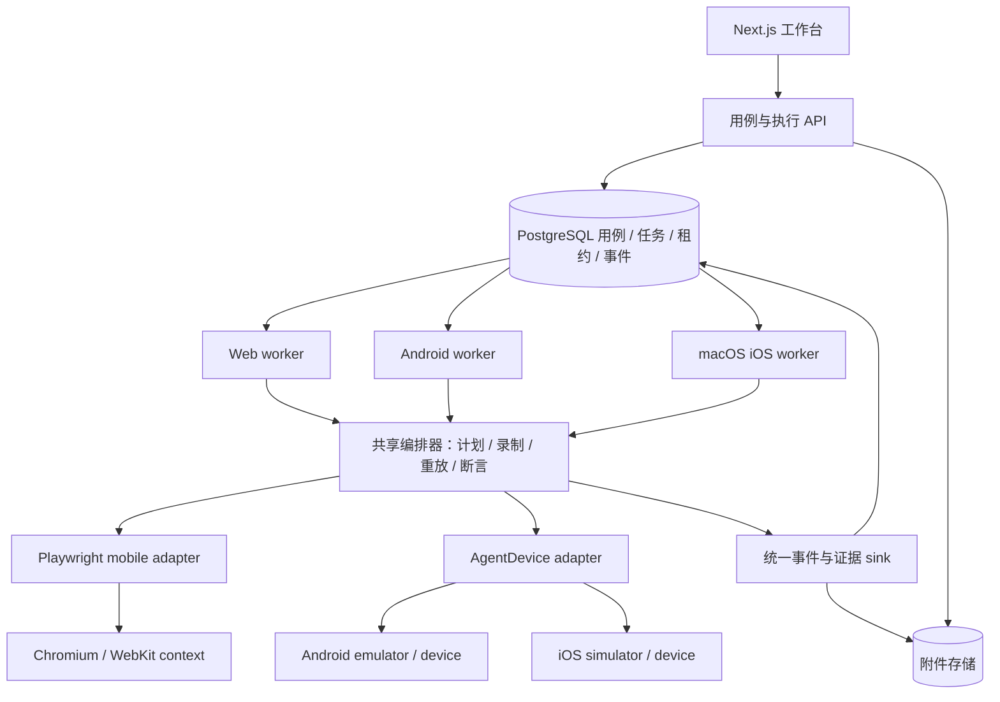

# 多平台自动化架构

本文保留首期架构决策、改造前基线和目标契约；首期验收的历史证据见 [实施记录](automation-implementation.md)。当前代码组织见 [Monorepo 结构](monorepo.md)，配置与升级操作见 [部署指南](deployment.md)。目标：Web 使用 Playwright mobile emulation；Android 和 iOS 使用 Callstack agent-device。本文中的接口是 testdog 内部契约，不是第三方 SDK 的直接签名。

## 架构决策

采用「统一编排 + 平台会话适配器 + 按资源调度的 worker」。业务意图、计划 DAG、分支、断言结果、录制版本和证据时间线共用；浏览器 DOM 与原生 accessibility 的观察、定位、动作、等待及附件采集分别实现。统一业务用例可以分别录制三个平台，动作录制只在兼容的平台与环境内重放。

Web 的 mobile 表示移动浏览器仿真：通过 Playwright devices 配置 viewport、userAgent、deviceScaleFactor、isMobile、hasTouch，并显式选择 Chromium 或 WebKit。它不提供真实 iOS/Android 系统验证。[Playwright 官方说明](https://playwright.dev/docs/emulation)。

原生端采用 agent-device 的命名会话和结构化快照；优先使用其 typed Node.js client，包装在独立适配器内。设备资源由 testdog 调度，agent-device 的本地设备占用作为第二层保护。refs 仅属于最新观察，不能保存为永久定位器。[agent-device 官方说明](https://github.com/callstack/agent-device)。安装时锁定经过验证的版本，禁止运行时拉取 latest；具体能力通过该版本和实际设备探测确认。



图中的编排器在各 worker 内运行，不增加单独的编排网络服务。首期调度设计使用 PostgreSQL；后续实现使用 Redis 提供实时通知与预览，当前协议见 [工作台文档](workspace.md)。

## 首期改造前的基线与目标

| 当前入口                                             | 现状                                     | 目标职责                                            |
| ---------------------------------------------------- | ---------------------------------------- | --------------------------------------------------- |
| `packages/server/src/runs/run.ts`                    | API 后台任务启动 Chromium，固定 1280×800 | worker 执行生命周期、选择 adapter、取消、超时及归档 |
| `packages/automation/src/planRunner.ts`              | 遍历 DAG 并统一编排动作、断言与重放      | Web 与原生 session 提供平台动作和观察能力           |
| `browserSession.ts`、`observer.ts`                   | 管理 Page 和 ARIA 观察                   | PlaywrightSession 内部实现                          |
| `planner.ts`、`compiler/schema.ts`                   | 动作含 css/ariaRef，等待含 newPage       | 保留意图 DAG；动作使用平台判别联合及能力约束        |
| `packages/server/src/runs/recorder.ts`、`locator.ts` | Page hooks、DOM 稳定定位、截图及 trace   | 通用事件 sink + adapter 录制定位与附件提供者        |
| `recordingScript.ts`                                 | 解析受限 Playwright 脚本                 | 保留 Web 编辑器；新增设备动作编辑器，共用版本化 IR  |
| `types.ts`、`packages/server/src/db/schema.ts`       | url/pageId/browserLogs 为中心            | target、surface、能力与平台快照                     |
| `store.ts`、`api/runs/route.ts`                      | 全局单运行锁，Next after 执行            | 入队 + worker 原子领取，按设备/浏览器 slot 互斥     |

不能把原生设备塞进伪造 Page，或给现有 DOM Target 添加几个可选字段后继续共用所有浏览器代码。

## 目标与执行快照

```ts
type TestTarget =
  | {
      platform: 'web';
      url: string;
      browser: 'chromium' | 'webkit';
      deviceProfile: string;
      locale?: string;
      timezoneId?: string;
    }
  | {
      platform: 'android' | 'ios';
      appId: string; // Android package 或 iOS bundle ID
      buildArtifactId?: string; // 已登记、校验过的构建附件
      deviceProfileId: string; // 调度约束，不是默认连接的首台设备
      launchUrl?: string; // 可选 deep link
      resetPolicy: 'preserve' | 'clear-data' | 'reinstall';
    };
```

UI 提供平台选择及不同表单：Web 填地址、浏览器和移动配置；原生填应用、设备配置、构建与初始化策略。共享 goal/tags，允许平台覆盖输入及预期。

Run 创建时冻结 target、goal、计划/录制版本；领取时补充实际设备 ID、OS、屏幕、应用 build hash、driver 版本、浏览器版本和已解析 mobile profile。重放使用源快照，不能读已修改用例或升级后的默认设备参数。

## 会话接口与动作契约

```ts
interface AutomationSession {
  readonly id: string;
  readonly platform: TestTarget['platform'];
  readonly capabilities: CapabilitySet;
  observe(signal: AbortSignal): Promise<Observation>;
  perform(action: PlatformAction, signal: AbortSignal): Promise<ActionResult>;
  wait(condition: PlatformWait, signal: AbortSignal): Promise<Observation>;
  check(assertion: PlatformAssertion, signal: AbortSignal): Promise<CheckResult>;
  resolveForRecording(action: PlatformAction, observation: Observation): Promise<ReplayBinding>;
  capture(request: CaptureRequest, signal: AbortSignal): Promise<ArtifactDescriptor[]>;
  close(): Promise<void>;
}
```

工厂 `adapter.open(target, resourceLease, signal)` 创建会话。上述辅助类型在实施阶段定义为严格 Zod schema，并使用平台判别联合校验；所有第三方对象留在 adapter 内。

- Observation：schemaVersion、sessionId、revision、capturedAt、surface（Web tab 或原生 app/screen）、结构化节点和可选截图引用。原生屏幕不要求有 URL。
- PlatformAction：Web 保留 navigate/click/fill/press；原生提供 launch/tap/fill/swipe/back 等，经能力检查后暴露。Web 导航和原生启动分别定义，不将 appId 当 HTTP 地址。
- 定位：Web 使用现有 role/label/testId 等；原生保存 accessibility 标识、resource ID 或 role + label + 上下文组合。实际 SDK 可提供哪些字段，以设备快照为准。匹配必须唯一，禁止静默选第一个。
- 临时引用：ref 必须携带 observation revision。每个改变 UI 的动作后重新观察；过期 ref 拒绝执行。原生同一 planner 响应的后续动作不能继续使用旧 refs。
- 等待：统一 timeout/deadline；具体条件区分 Web URL/newPage 与原生元素、应用状态。采用有界轮询或后端 settle，无条件 sleep 不能证明完成。
- CapabilitySet：记录可用动作、观察字段、断言和附件类型。规划器只收到可执行集合，执行前再次校验；缺失必需能力返回明确错误，不降级到另一个驱动。

PlanRunner 仅处理 DAG、依赖、分支、动作预算和 hooks。Observer 由 session 提供；Planner 输入 goal、Observation、capabilities 和已完成动作。现有每意图 20 次动作、15 秒等待预算可先保留为配置，整体超时覆盖模型与设备命令。

断言优先结构化验证，如 visible/text/value；自然语言验证通过共享 EvidenceEvaluator 执行，只读并返回证据。现有模型只接收文本，因此原生 screenshot 不能直接作为视觉验证输入；需要视觉验证时另配支持图片的 evaluator。证据不足明确失败。

## 两类 adapter

### Playwright mobile

根据 browser 选择 launch 类型；校验 deviceProfile，取出 device descriptor 并显式解析 browser 设置，将其余参数用于 newContext。新 mobile 用例默认使用项目中验证过的 Android/Chromium 配置，提供 iPhone/WebKit 配置。不要在展开 descriptor 后又覆盖成桌面 viewport；录像尺寸取 resolved viewport。点击在需要触摸语义时映射为 locator.tap，按键等行为仍由 Web schema 定义。

每个 run 使用独立 context，保留 popup/tab 管理、DOM 稳定定位、Console/Network、视频和 Playwright Trace。取消时只关闭该 run 拥有的 context/进程。旧桌面录制保留 desktop legacy profile；不能直接转成 mobile 后宣称重放兼容。

### AgentDevice Android / iOS

同一适配器按 platform 配置，底层调用 agent-device；无需为 Android/iOS 复制 PlanRunner。使用 `runId + attempt` 命名会话，明确绑定租约内设备，禁止依赖默认设备或共享默认会话。

执行顺序：设备健康检查 → 安装/初始化策略 → 启动 app/deep link → 快照 → 定位与动作 → 稳定后重新观察 → 检查预期 → 归档 → 关闭会话与释放设备。禁止模型直接运行任意 shell。若需要 CLI fallback，使用固定可执行文件和参数数组、结构化输出校验、命令 deadline 及进程组终止，不能拼接 shell 字符串。

Android worker 配置 Android SDK/ADB；iOS 本地 worker 配置 macOS/Xcode。首期验收覆盖 emulator 和 simulator，真机接入仍走同一契约，但要另外验证签名、设备授权和后端支持，不把模拟器通过视为真机通过。

截图是原生证据基线；视频、系统日志、网络和 trace 按运行时能力采集。原生 trace 保存为独立格式并标明 producer，不能当作 Playwright Trace 打开。WebView 首期作为原生 accessibility 表面处理；需要 DOM 自动化的混合应用另加明确能力与上下文切换，不能静默接入 Playwright。

## 调度与失败恢复

Next.js API 仅校验、保存快照、入队并返回 202，独立长驻 Node worker 执行。Web worker 可运行于 Linux/macOS；Android worker 位于有 SDK 的主机；iOS worker 位于 Mac。开发模式可由一个本地 worker 承担多个平台，但仍按 slot/设备隔离。

状态：`queued → preparing → running → finalizing → passed/failed/cancelled`；排队取消直接终结；已领取任务先停止执行并归档。超时、失联归为 failed，并附 errorCode，避免无限增加产品状态。

新增 worker 注册与 resource 表，资源键为稳定的 hostId/deviceId 或 browser slot。事务使用 `FOR UPDATE SKIP LOCKED` 匹配能力并领取任务，同时取得资源租约。run 和 resource 都带 owner、attempt、leaseUntil、单调递增 fencingToken。所有步骤/附件/状态写入验证 token，事件按 runId/attempt/sequence 去重。

沿用 5 秒心跳、60 秒失联阈值作为初始配置；执行上限在准备完成后计时，排队、安装与归档各有独立上限。取消通过数据库标记传播，worker 观察后 abort 模型、停止会话并归档。

数据库 fencing 只能阻止旧 worker 写结果，无法停止旧设备命令。资源失联必须进入 quarantined，确认旧进程已退出且后端 claim 清理完成、健康检查通过后才可再分配。不能仅因租约过期就让新 worker 接管同一设备。中断的业务动作不自动续跑；重试创建新 attempt/run，避免重复下单等副作用。

归档在独立且有界的清理信号下执行，避免取消信号阻止保存截图。步骤失败与附件归档失败分别记录，保留主要错误；必要证据丢失影响结果完整性并在 UI 明示。

## 数据与 API 演进

1. test_cases 增加 versioned target JSONB；test_runs 增加 targetSnapshot、environmentSnapshot、capabilities、attempt/fencingToken、队列/准备/归档时间。
2. 增加 workers/resources/leases（资源唯一约束）、run_events；现有 workerId 从入队时必填改为领取后赋值，扩展数据库 status check。
3. run_steps 增加 versioned platform action、locator binding、surface 和 observationRevision；run_artifacts 增加 surface、producer、format，允许 snapshot/log/device-trace 类型。保留旧 pageId/pageUrl 可读兼容字段。
4. browserLogs 保持 Web 专用；原生日志使用带 source 的诊断事件。UI 以能力显示日志/视频/trace，没有采集能力时显示原因。
5. recording_versions 增加 schemaVersion、platform、targetSnapshot 和兼容性要求。Web 继续受限 Playwright 编辑；原生使用结构化动作编辑/生成预览，统一保存经 schema 校验的 IR。
6. API 的 target 使用 discriminated union；原生无需 url。运行详情返回 resolved target、阶段、能力和完整性；新增 worker/resource 查询供设备选择。附件通过授权 API 读取，共享对象存储生产化，本地单机可保留磁盘。

首期采用 expand/backfill/cutover 数据兼容策略，为历史记录回填 `web + legacy desktop Chromium`，保留原录制与附件，不将历史执行改为 mobile。当前迁移执行顺序统一见 [数据库迁移与升级](deployment.md#数据库迁移与升级)。

## 录制与重放规则

录制前解析当前 target，保存稳定定位绑定、执行结果和步骤前后观察/截图。临时 DOM ariaRef 或 agent-device ref 不作为可重放定位；仅坐标动作默认 replayable=false，若未来开放需显式固定屏幕/方向/比例及前置证据。

重放使用 frozen IR，重新定位并检查唯一性，不调用模型重新规划或修复动作。语义断言/分支可以调用只读 evaluator，且沿用现有「分支与原记录不一致即失败」规则。跨平台重放返回 409；OS/build/profile 不满足录制兼容性时在执行前拒绝，允许用户另建新录制验证版本变化。

原生录制使用 testdog IR 作为唯一事实源，agent-device 自身脚本可作为导出附件，避免两套重放引擎各自决定分支。新录制是否可重放由全部动作绑定、能力和步骤结果共同决定。

## 实施顺序与验收

| 阶段 | 交付                                       | 验收证据                                                                                                    |
| ---- | ------------------------------------------ | ----------------------------------------------------------------------------------------------------------- |
| 1    | 抽出 session/PlanRunner/事件 sink          | 现有录制、popup、停止、分支、编辑重放及附件回归通过；共享模块无 Playwright Page 引用                        |
| 2    | target schema、mobile Web、历史兼容迁移    | Chromium 与 WebKit 移动配置真实运行；触摸/viewport/UA 校验；旧桌面录制仍可重放                              |
| 3    | PostgreSQL 队列、独立 worker、资源租约     | API 重启不丢任务；双 worker 不重复领取；过期 owner 无法写入；失联设备隔离；取消可终结                       |
| 4    | AgentDevice adapter、设备选择、原生证据 UI | Android emulator 与 iOS simulator 各完成启动→输入→点击→等待→断言→截图→稳定定位重放；过期 ref 拒绝、歧义失败 |
| 5    | 故障与部署验证、真机按需接入               | 超时/断连/模型失败/归档失败保留证据并释放或隔离资源；同设备互斥、不同设备并行；版本不兼容重放拒绝           |

共享合同测试验证动作 schema、能力拒绝、revision、事件顺序及关闭幂等；adapter 集成测试用真实浏览器和本地测试 app。调度测试必须包含旧 worker 存活的租约超时，证明不会并发控制同一设备。CI 的模拟 adapter 不能作为 Android/iOS 实际可用的验收证据。

首期实施的历史进度保存在 [实施记录](automation-implementation.md)。验收需要核对当前代码、迁移与真实浏览器/设备结果，不能用合同模拟测试替代设备验证。

### Web 实现目录

Web 专用实现集中在 `packages/engine/src/platform/web/`。`webActions.ts` 执行浏览器动作，`webLocator.ts` 解析元素定位器，供 `PlaywrightSession` 和录制定位共用。Web 与原生工作台运行统一通过 `PlanRunner` 编排；平台差异由各自的 session、planner 和 replay adapter 处理。

### 执行依赖装配与平台边界

`packages/server/src/execution/runtime/index.ts` 按目标平台分派给 `web.ts` 或 `native.ts`，各平台分别装配 session、planner、注入模型的 `SemanticEvaluator` 与证据采集，并管理自己的初始化和清理。`PlanRunner` 只依赖统一接口，不选择具体平台或模型，也不读取旧工作台录制格式。

Web 和原生脚本解析返回纯 `RecordingOperation[]`，录制版本与重放快照只保存操作字段。历史 `ExecutionStep` 在创建重放时提取为录制操作；执行时通过 `packages/contracts/src/runs/lib/replay.ts` 转换为 `ReplayStep`，真实步骤的 ID、状态、时间和证据由录制器生成。内部动作统一为带平台标记的 `action`，确定性断言统一为 `platformAssertion`；Playwright 方法名在脚本解析／导出边界转换，重放时不再兼容或转换旧字段。历史步骤、录制版本、冻结快照、实时事件、问题证据和幂等响应在数据库迁移中统一。平台 session 的 `prepareReplayStep` 决定页面选择与重放规则：Web 弹窗等待不切回原页面，瞬时 ARIA 引用不能重放；原生会话继续绑定已租用的设备和应用。

session 的 `executionPolicy.reobserveAfterAction` 声明动作后是否必须重新观察。原生会话逐动作重新规划，Web 可执行同一观察中的批量动作；任一会话 revision 变化都使剩余批次失效。自然语言断言和分支通过注入的 `Evaluator` 使用当前观察判断，确定性平台断言继续交给 session 检查。

模型请求、响应和工具定义集中在 `engine/llm/contracts.ts`，不依赖供应商 SDK。`TextCompiler`、Web/Native planner 和 `SemanticEvaluator` 都接收 `ModelClient`，不直接引用 DeepSeek 或 OpenAI SDK。`server/infrastructure/model.ts` 是默认模型的选择点，编译与运行时装配共用同一个客户端；新增模型适配器实现该接口后在此选择。

稳定录制定位由 `platform/web/recordingLocator.ts` 提供，`RecordedAction` 定义在 `platform/web/types.ts`。Web session 与服务端录制器共用该平台能力；工作台执行记录和数据库表定义引用 Web 领域类型，session 不再导入工作台服务端定位模块。
