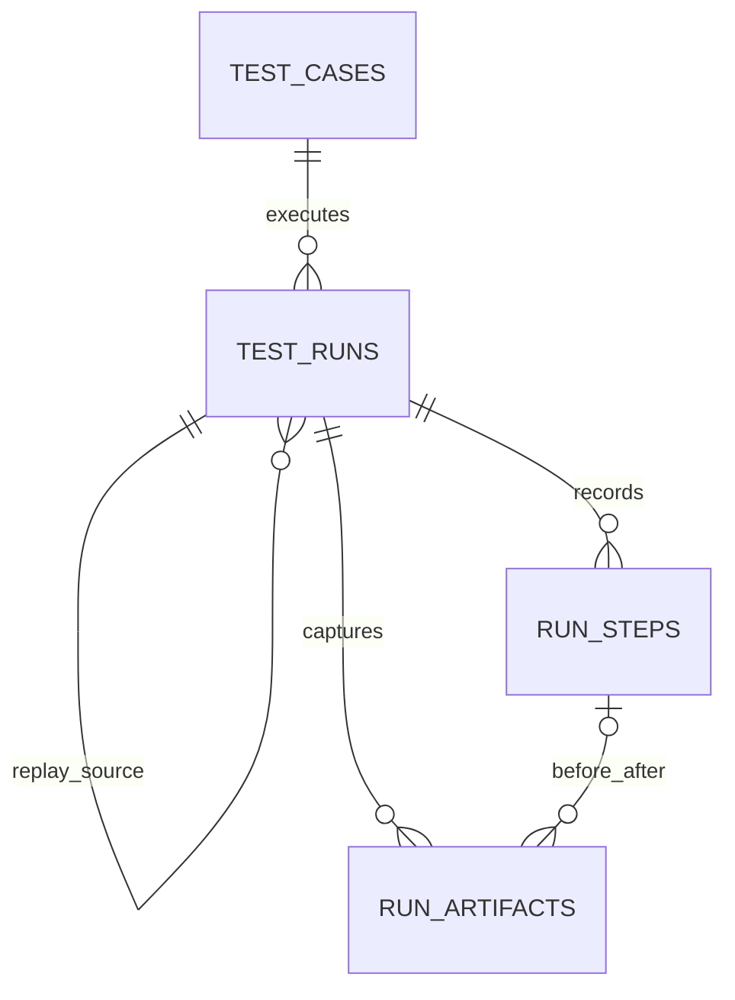

# 工作台数据模型与 API

## 关系与存储



| 表              | 主要字段                                                                                          | 用途                                           |
| --------------- | ------------------------------------------------------------------------------------------------- | ---------------------------------------------- |
| `test_cases`    | UUID、名称、URL、自然语言步骤、标签、创建和更新时间                                               | 可编辑的测试定义                               |
| `test_runs`     | 用例 ID、原执行 ID、用例快照、模式、状态、计划、日志、执行租约、起止时间、耗时、错误              | 不受用例后续编辑影响的执行记录                 |
| `run_steps`     | 执行 ID、连续序号、类型、状态、页面编号和 URL、稳定定位器和动作、断言、条件、证据、起止时间、错误 | 一次实际导航、输入、点击、等待、条件判断或断言 |
| `run_artifacts` | 执行 ID、可选步骤 ID、类型、前后阶段、页面、时间和相对时间、私有文件路径、MIME、大小              | 截图、每个页面的视频和 Trace                   |

所有主键使用 UUID。步骤序号在执行内唯一，外键约束保证记录归属。删除用例会将历史记录的用例 ID 置空，保留快照。附件文件路径不出现在 API 输出中，只通过按执行和附件 ID 校验的接口访问。

历史与录制版本索引覆盖时间和 ID 的排序次序。租约索引只包含执行中的记录，避免将已结束的历史执行纳入租约扫描。附件按相对时间、采样时间和 ID 排序，同一毫秒内的截图保持稳定顺序；时间轴索引使用相同字段。

执行状态为 `queued`、`preparing`、`running`、`finalizing`、`passed`、`failed`、`cancelled`。步骤状态为 `running`、`passed`、`failed`，取消时未完成的步骤标记为中断。模式为 `record` 或 `replay`。数据库检查约束限制状态、类型、正序号和非负大小。

执行结束和租约超时恢复在同一事务中更新执行与未完成步骤；步骤更新失败时，执行状态也回滚。超时恢复只处理本次过期的执行，不扫描失败历史的步骤。重复提交结束结果不会覆盖已有终态，耗时根据数据库保存的开始时间计算。状态与租约逻辑集中在 `src/workspace/server/scheduler.ts` 和 `src/workspace/server/lease.ts`，业务错误定义在 `src/workspace/server/errors.ts`。

续约和结束写入都校验当前执行器身份。执行归属变化后，旧执行器停止工作，不写入终态或中断新执行器的步骤；租约丢失与用户取消分别处理。过期恢复仍可跨执行器标记已失联的执行。

附件归档会独立尝试最后截图、Trace 和各页面录像，单项失败不会阻止其他附件保存。录制停止时先停止采样、解绑页面监听，再关闭上下文；重复停止复用同一次归档。后台采样或归档错误会进入执行错误信息。租约续约和五分钟超时控制持续到附件归档与浏览器清理结束。

## 接口

平台使用版本化 target：Web 包含 URL/browser/deviceProfile，原生包含 appId/deviceProfileId/buildArtifactId/resetPolicy/launchUrl。可选 inputs 保存普通值或 secretRef，原生 evidence 按能力请求 video/trace/logs。运行详情提供冻结 target、实际 environment、capabilities 和 evidenceComplete。

`POST /api/run-batches` 接收 testId 与 variants（每项 target 和可选 goal），事务内创建独立 run 并返回 batchId。`GET /api/resources` 返回 workers/resources，`GET /api/builds` 返回构建身份与摘要，均不暴露私有路径。原生录制编辑保存版本化 JSON IR，支持 structured check、semantic assertion 和分支。

生产模式默认要求认证，附件也受认证与运行归属校验保护。跨主机附件可使用私有 S3。部署切换与实测证据见 [实施记录](automation-implementation.md)。

所有响应为 JSON，附件接口除外。创建和更新字段均在服务器用 Zod 校验。错误响应含 `message`：400 参数错误或不符合重放条件，404 记录不存在，409 平台/录制不兼容或停止已结束的记录，503 数据库不可用。发起执行返回 202，表示后台工作已接受，不表示测试通过。

发起执行的请求只接受对应模式的字段：录制指定 `testId`，或 `case` 与可选 `url`；重放必须指定 `mode: "replay"`、`sourceRunId` 与可选 `recordingVersionId`。未知字段和混合模式参数返回 400。API 与仓库使用同一校验定义，校验失败不会创建执行或占用运行名额。

执行详情收到 400/404 时显示不可用状态并停止自动轮询，可手动重试或返回列表。临时读取错误保留重试入口；已有执行数据时继续显示最后读取的记录。格式不正确的执行地址和不存在的页面显示自定义 404 页面，页面渲染失败则由错误边界提供恢复入口。

工作台 JSON 请求的客户端超时为 15 秒，覆盖响应头与响应体读取；结束或取消后清理计时器与监听。读取超时可重试，写入超时提示先刷新确认操作结果。该超时不改变后台测试的五分钟执行上限。

### 用例

- `GET /api/tests` → `{ tests: TestCase[] }`，按更新时间倒序。
- `POST /api/tests` → HTTP 201 `{ test: TestCase }`。
- `PATCH /api/tests/:id` → `{ test: TestCase }`，整体更新可编辑字段。
- `DELETE /api/tests/:id` → `{ success: true }`，保留历史执行。

创建和修改请求：

```json
{
  "name": "验证登录页",
  "url": "https://app.example.com",
  "goal": "点击登录按钮，验证页面包含邮箱输入框和提交按钮。",
  "tags": ["smoke", "login"]
}
```

名称最多 120 字符、用例最多 20000 字符、标签最多 10 个，每个最多 30 字符。URL 限定 HTTP(S)。

用例写入在 API 和仓库两层使用同一校验定义，名称、步骤和标签会去除首尾空白。ID、创建时间等受保护字段不接受调用方覆盖；无效更新不会修改已有记录。

### 执行

- `GET /api/runs` → `{ runs: RunSummary[] }`，按开始时间倒序；时间相同时按 ID 倒序。数据库只读取摘要字段，不加载目标描述、计划、日志、录制快照、步骤或附件。完整记录通过详情接口读取。
- `GET /api/runs/:id` → `{ run: TestRun }`，包含全部步骤、日志和附件元数据。界面在执行中每 1.5 秒查询。

详情响应带有按完整 JSON 内容计算的 `ETag`。发送匹配的 `If-None-Match` 时返回无响应体的 304；执行详情轮询按页面独立保留上一份数据，304 时复用对象。数据库仍会读取最新记录并检查租约，状态、步骤、画面或日志变化都会产生新 ETag。报告导出始终读取完整 JSON。

- `POST /api/runs` → HTTP 202 `{ success: true, run: TestRun }`。
- `DELETE /api/runs/:id` → `{ success: true }`，申请停止，运行器终止模型请求和浏览器，最终状态为 `cancelled`。这个接口不会删除历史记录。

结果列表与执行详情的 JSON 导出均重新读取完整执行记录，包含步骤、计划、日志和附件元数据。运行中的报告表示导出时读取的快照，附件二进制仍通过独立下载链接访问。读取失败时显示错误并允许重试，不生成缺失步骤的报告。

录制已保存的用例：

```json
{ "testId": "用例 UUID", "mode": "record" }
```

重放已完成的记录：

```json
{ "mode": "replay", "sourceRunId": "原执行 UUID" }
```

兼容直接运行自然语言用例：

```json
{ "mode": "record", "case": "打开首页，验证标题。", "url": "https://example.com" }
```

直接执行时 URL 可省略，测试必须自行描述导航目标。API 只持久化入队；独立 worker 按资源采用 FOR UPDATE SKIP LOCKED 原子领取，运行过程中续约并检查 fencingToken。失联资源进入隔离，旧 worker 不能写入步骤、附件或结果。

### 步骤与重放

步骤 `action` 保存原动作类型、输入值、稳定定位器，以及是否为密码输入。录制期间先验证定位器唯一且对应实际元素，优先使用 test ID、标签、角色与可访问名称、placeholder，随后使用 ID 或有语义的属性选择器。只有临时 ARIA ref 或不可唯一定位的动作将标记为不可重放，不使用 DOM 序号冒充稳定定位。

重放使用原步骤顺序与页面编号；新标签页按创建顺序映射。分支重新读取页面证据，结果必须与录制的分支一致；断言重新验证。页面不存在、定位器失效、分支变化或断言失败时保存新的失败记录，不自动改写原动作。原执行始终保留。

### 画面附件

`GET /api/runs/:id/artifacts/:artifactId` 根据元数据读取私有附件，支持视频 `Range` 请求（206 / 416）。`?download` 返回可下载的附件；Trace 默认作为下载文件。

截图元数据包含 `stage`（`before`、`after`、`live`、`final`）、页面编号、页面 URL、采样时间和执行起点后的 `elapsedMs`。连续画面以一秒间隔采样，操作前后截图独立记录；截图不是视频帧精度的直播。WebM 视频按页面录制，页面关闭或执行结束后可播放。

采样器从已有页面开始采集，跟随运行器最近选择的页面；当前页面关闭时，回退到最近登记且仍打开的页面，继续采集实时画面和最终截图。页面编号始终保留，关闭标签页不会改变后续重放映射。

附件通过执行 ID 和附件 ID 联合查询，并校验其文件路径位于配置的附件根目录。归档路径仅内部使用，不接受客户端指定路径。

在支持 POSIX 权限的文件系统上，浏览器录制开始前将执行附件目录设为 `0700`；截图、归档录像和 Trace 使用 `0600`。已有执行目录在准备时也会收紧权限。

## 保留的旧接口

`GET/POST /api/cases` 与 `/api` 健康检查保留兼容原项目。旧 `/api/cases` 操作原 `case` 表，不作为新工作台的数据源。

## 嵌套计划画板与录制编辑

执行详情页提供「执行回放」「计划画板」「编辑录制」三个视图。
画板从 compiler 的 `rootId + nodes` 图恢复 group 的嵌套关系和 branch 的 YES/NO 路径。
共享节点显示引用，依赖节点和独立节点另外展示，虚线显示 dependsOn。
可拖动背景平移，Ctrl/⌘ + 滚轮缩放，也可用缩放、重置和适应画板按钮。
点击节点展示预期及关联的录制步骤；点击步骤返回对应执行画面。
新录制保存 `planNodeId`，旧录制仍可展示计划，但无法补推精确的步骤关联。

CodeMirror 编辑器将录制转换为逐条 `await` 调用，支持增删、修改和排序：

```js
await page1.goto('https://example.com');
await page1.getByLabel('Name', { exact: true }).fill('Grace');
await page1.getByRole('button', { name: 'Continue', exact: true }).click();
await expect(page1.getByRole('heading')).toHaveText('Welcome Grace');
await expectPage(page1, '欢迎信息可见且表单已提交');
```

`page1` 为初始页，`page2` 等按打开顺序编号。定位器支持 getByRole、getByLabel、
getByPlaceholder、getByTestId、getByText、locator 和 nth。动作支持 goto/click/fill/press。
原有模型断言和分支用 `expectPage` / `expectBranch` 表达；原生 Playwright 断言支持
`toBeVisible` / `toHaveText` / `toContainText` / `toHaveValue` / `toHaveURL` 及 `.not`，超时 5 秒。
等待用 `waitForTimeout(1000..5000)` 或 `waitFor(page, condition, value, timeoutMs)`。
`// @node id` 可保留操作与计划节点的关联。

这是一种经过校验的 Playwright 调用语法：服务器解析调用并交给执行器，
不 eval 脚本；变量声明、循环、导入和任意 JavaScript 调用不受支持。
不稳定的 aria-ref 定位器需要手动替换后才能保存。
下载的 `.js` 文件使用平台提供的页面编号和辅助函数，适合备份编辑稿；独立运行时须提供这些上下文。

录制版本的查询与保存集中在 `src/workspace/server/recordings.ts`，脚本解析不进入普通用例和执行查询模块。版本列表检查执行是否存在时只读取 ID；保存版本只读取执行状态和计划，避免加载日志与录制快照。

编辑后的版本保存在 `recording_versions`，不覆盖原步骤和画面。
重放启动时将选中版本的步骤复制到 `test_runs.recordingSteps`，执行中后续版本不会影响此快照。
失败录制也可以修改为新版本并重放；未编辑的原录制仍要求成功且可重放。

- `GET /api/runs/:id/recording`：列出版本的 ID、执行 ID、脚本和创建时间，不传输重复的解析步骤。
- `POST /api/runs/:id/recording`，`{code}`：校验后保存独立版本，返回 201，版本字段与列表一致。解析步骤保留在数据库，用于重放快照。
- `POST /api/runs`，`{mode:"replay",sourceRunId,recordingVersionId}`：重放选中的编辑版本，返回 202。

需运行 `pnpm db:migrate` 应用新增的版本表与节点、原生断言、重放快照字段。

## 多平台扩展（实施中）

用例支持 versioned `target`，Web 的 `url` 与原生的 `appId/deviceProfileId` 分别校验。新 Web 用例默认为 Pixel 7 / Chromium；迁移只为历史记录回填 legacy-desktop，不改变原录制。

```json
{
  "name": "登录",
  "goal": "填写用户并提交，验证登录成功",
  "tags": ["smoke"],
  "target": {
    "schemaVersion": 1,
    "platform": "ios",
    "appId": "com.example.app",
    "deviceProfileId": "iphone",
    "resetPolicy": "preserve"
  }
}
```

- `GET /api/resources`：已登记资源与 worker，包含 available/busy/quarantined 状态。
- `GET /api/builds`：构建元数据与摘要，私有路径不输出。
- `POST /api/run-batches`：`{testId, variants:[{target, goal?}]}`，在同一事务创建各平台独立执行并以 batchId 关联。
- 原生录制版本使用 `{schemaVersion:1, platform, steps}` JSON，保留语义断言与分支，拒绝临时 refs 和坐标手势。

执行详情增加 targetSnapshot、environmentSnapshot、capabilities、resourceId、batchId 和 evidenceComplete。原生步骤使用 platformAction，旧 Web action/pageId/pageUrl 可继续读取。原生截图 MIME 为 image/png，附件下载保留正确扩展名。

当前实现与尚未完成的项目见 [实施记录](automation-implementation.md)。
