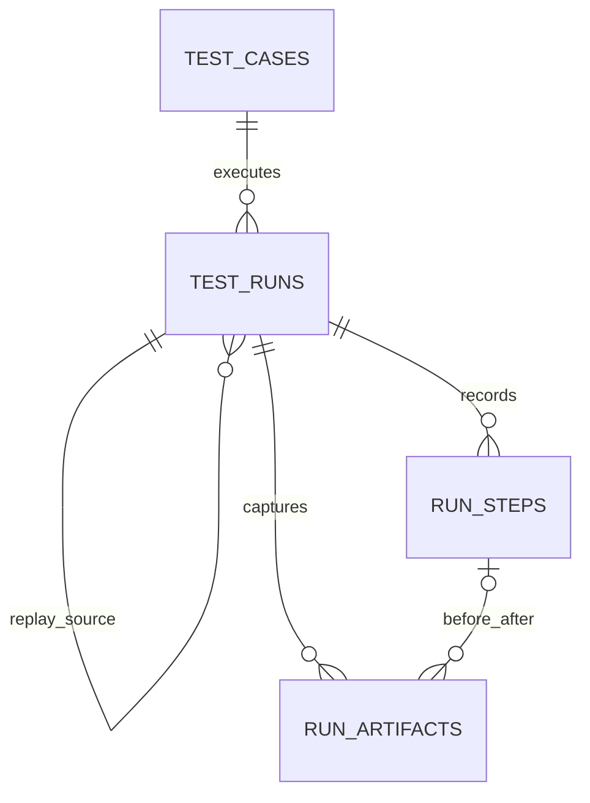

# 工作台数据模型与 API

## 关系与存储



| 表              | 主要字段                                                                                          | 用途                                           |
| --------------- | ------------------------------------------------------------------------------------------------- | ---------------------------------------------- |
| `test_cases`    | UUID、名称、URL、自然语言步骤、标签、创建和更新时间                                               | 可编辑的测试定义                               |
| `test_runs`     | 用例 ID、原执行 ID、用例快照、模式、状态、计划、日志、执行租约、起止时间、耗时、错误              | 不受用例后续编辑影响的执行记录                 |
| `run_steps`     | 执行 ID、连续序号、类型、状态、页面编号和 URL、稳定定位器和动作、断言、条件、证据、起止时间、错误 | 一次实际导航、输入、点击、等待、条件判断或断言 |
| `run_artifacts` | 执行 ID、可选步骤 ID、类型、前后阶段、页面、时间和相对时间、私有文件路径、MIME、大小              | 截图、每个页面的视频和 Trace                   |

所有主键使用 UUID。步骤序号在执行内唯一，外键约束保证记录归属。删除用例会将历史记录的用例 ID 置空，保留快照。附件文件路径不出现在 API 输出中，只通过按执行和附件 ID 校验的接口访问。

历史与录制版本索引覆盖时间和 ID 的排序次序。租约索引只包含执行中的记录，避免将已结束的历史执行纳入租约扫描。附件按相对时间、采样时间和 ID 排序，同一毫秒内的截图保持稳定顺序；时间轴索引使用相同字段。

执行状态为 `queued`、`preparing`、`running`、`finalizing`、`passed`、`failed`、`cancelled`。步骤状态为 `running`、`passed`、`failed`，取消时未完成的步骤标记为中断。模式为 `record` 或 `replay`。数据库检查约束限制状态、类型、正序号和非负大小。

执行结束在同一事务中保存状态、errorCode、evidenceComplete、错误与未完成步骤；事务提交前收到取消时，状态与错误码都以取消为准。错误码区分 CANCELLED、PREPARATION_TIMEOUT、EXECUTION_TIMEOUT、LEASE_LOST、EXECUTION_FAILED 与 FINALIZATION_FAILED，附加归档错误不覆盖主要失败，最终错误统一脱敏。执行结束和租约超时恢复在同一事务中更新执行与未完成步骤；步骤更新失败时，执行状态也回滚。超时恢复只处理本次过期的执行，不扫描失败历史的步骤。重复提交结束结果不会覆盖已有终态，耗时根据数据库保存的开始时间计算。状态与租约逻辑集中在 `packages/server/src/scheduling/scheduler.ts` 和 `packages/server/src/scheduling/lease.ts`，业务错误定义在 `packages/server/src/shared/errors.ts`。

worker 负责登记资源和领取任务，`runs/run.ts` 只执行携带当前任务租约的调用；测试通过 `testing/executeTestRun.ts` 领取后进入同一执行路径。续约和结束写入都校验当前执行器身份。执行归属变化后，旧执行器停止工作，不写入终态或中断新执行器的步骤；租约丢失与用户取消分别处理。过期恢复仍可跨执行器标记已失联的执行。

附件归档会独立尝试最后截图、Trace 和各页面录像，单项失败不会阻止其他附件保存。录制停止时先停止采样、解绑页面监听，再关闭上下文；重复停止复用同一次归档。实时预览采样错误不会影响执行结果；必要证据与归档错误会进入执行错误信息。准备与执行分别有两分钟、五分钟上限；证据归档和会话清理分别使用独立的三十秒、十秒上限，租约续约持续到最终结果保存与资源释放。Web 和原生都在归档失败或卡住时继续尝试关闭会话，关闭未确认的资源保持隔离。准备失败保留主要错误与清理错误，并将已确认的资源健康状态交给 worker。

## 接口

target 是目标配置的事实来源，Web URL 由 target.url 推导，原生 URL 统一为空；历史缺失的 target 由迁移回填，旧 URL 列已移除。列表、详情、搜索与 worker 使用同一目标语义。网站地址的校验与空白处理由同一 schema 提供，默认 Web 目标从校验后的地址生成。切换执行目标时将所选目标冻结到运行快照。重放仍要求目标与原录制完全兼容。

平台使用版本化 target：Web 包含 URL/browser/deviceProfile，原生包含 appId/deviceProfileId/buildArtifactId/resetPolicy/launchUrl。原生 evidence 按能力请求 video/trace/logs。运行详情提供冻结 target、实际 environment、capabilities 和 evidenceComplete。

`POST /api/run-batches` 接收 testId 与 variants（每项 target 和可选 goal），事务内创建独立 run 并返回 batchId。`GET /api/resources` 返回共享资源容量目录（不含任务归属、执行 ID、租约及 worker 详情），`GET /api/builds` 返回构建身份与摘要，均不暴露私有路径。原生录制编辑保存版本化 JSON IR，支持 structured check、semantic assertion 和分支。

生产模式默认要求认证，附件也受认证与运行归属校验保护。跨主机附件可使用私有 S3。部署切换见 [部署指南](deployment.md)，首期实测的历史证据见 [实施记录](automation-implementation.md)。

所有响应为 JSON，附件接口除外。创建和更新字段均在服务器用 Zod 校验。错误响应含 `message`：400 参数错误或不符合重放条件，404 记录不存在，409 平台/录制不兼容或停止已结束的记录，503 数据库不可用。发起执行返回 202，表示后台工作已接受，不表示测试通过。

发起执行的请求只接受对应模式的字段：录制指定 `testId`，或 `case` 与可选 `url`；重放必须指定 `mode: "replay"`、`sourceRunId` 与可选 `recordingVersionId`。未知字段和混合模式参数返回 400。API 与仓库使用同一校验定义，校验失败不会创建执行或占用运行名额。

执行详情收到 400/404 时显示不可用状态并停止自动轮询，可手动重试或返回列表。临时读取错误保留重试入口；已有执行数据时继续显示最后读取的记录。格式不正确的执行地址和不存在的页面显示自定义 404 页面，页面渲染失败则由错误边界提供恢复入口。

工作台 JSON 请求的客户端超时为 15 秒，覆盖响应头与响应体读取；结束或取消后清理计时器与监听。读取超时可重试，写入超时提示先刷新确认操作结果。该超时不改变后台测试的五分钟执行上限。

### 用例

新建测试默认打开文本输入 modal，输入操作与预期结果后由 AI 创建画板；也可以直接进入独立的画板页面手动创建。画板不使用 modal，也不显示工具栏或节点属性侧栏；点击卡片文字原位编辑，悬停显示拖拽排序、复制和删除操作。草稿与设置保存在当前标签页的 sessionStorage，刷新页面可恢复，保存成功后清除。名称自动生成，可在画板 Settings 侧栏修改；平台、设备和标签也在侧栏设置。画板使用宽卡片与纵向连线，在连线上的 ＋ 菜单插入 Act、Assert、Login、Files、Screenshot、分组或分支。保存时检查步骤和目标配置，转换失败保留草稿。创建与编辑支持文本和步骤树两种模式。`POST /api/tests/compile` 接收结构化编译请求：`goal`、可选 Web `url`、`currentPlan` 与 `context`（platform、appId），通过 AI 返回经可执行校验的 `plan`，不保存用例。转换失败保留文本，可重试。生成中点击关闭或按 Escape 会取消请求并保留描述与画板，可立即重试；离开页面自动终止请求，迟到结果不会覆盖后续编辑。用例创建/更新接受可选 `plan`（传 `null` 清除），支持分组、任务、断言、条件分支与前置依赖。画板编辑保留节点 ID，阻止无效引用和循环；分组内可调整执行顺序。

执行创建时冻结用例的树到运行 `plan`，后续编辑用例不影响已有运行；执行使用该树，无需重新编译文本。指定文本 goal override 时重新编译。旧文本用例仍在执行时生成计划，与画板共用编译请求契约。运行详情继续使用同一画板展示计划与节点对应的执行步骤。

草稿结构使用 `PlanSchema`，允许空分组；编译结果、保存用例和草稿试跑共用 `ExecutablePlanSchema`，要求根节点可到达至少一个任务，纯验证任务必须包含预期结果。条件路径外不得直接引用分支中独有的步骤，包括依赖和重复的子节点引用；分支后的任务应依赖分支节点，路径内依赖和两条路径共用的节点仍有效。所有节点必须通过子节点或依赖连接到根节点，断开的步骤不能保存或执行。步骤与预期直接使用填写的文本。

重放入队时在事务中复制来源计划、环境信息和按序号排列的步骤，指定录制版本时复制该版本的步骤。worker 按重放模式使用本次快照并检查环境兼容性，不再随来源变化；来源删除后仍可执行已提交的重放。历史未保存快照的重放由迁移回填；执行器仅使用冻结快照，不降级为重新录制。相关数据库变更按 [迁移流程](deployment.md#数据库迁移与升级) 应用。

- `GET /api/tests` → `{ tests: TestCase[], latestRuns: RunSummary[], nextCursor: string | null }`，按更新时间与 ID 倒序。
- `POST /api/tests` → HTTP 201 `{ test: TestCase }`。
- `PATCH /api/tests/:id` → `{ test: TestCase }`，整体更新可编辑字段。
- `DELETE /api/tests/:id` → `{ success: true }`，保留历史执行。

创建和修改请求：

```json
{
  "name": "验证登录页",
  "url": "https://app.example.com",
  "goal": "点击登录按钮，验证页面包含邮箱输入框和提交按钮。",
  "tags": ["smoke", "login"]
}
```

名称最多 120 字符、用例最多 20000 字符、标签最多 10 个，每个最多 30 字符。URL 限定 HTTP(S)。

用例写入在 API 和仓库两层使用同一校验定义，名称、步骤和标签会去除首尾空白。ID、创建时间等受保护字段不接受调用方覆盖；无效更新不会修改已有记录。

### 执行

- `GET /api/runs` → `{ runs: RunSummary[], nextCursor: string | null }`，按开始时间倒序；时间相同时按 ID 倒序。数据库只读取摘要字段，不加载目标描述、计划、日志、录制快照、步骤或附件。完整记录通过详情接口读取。
- `GET /api/runs/:id` → `{ run: TestRun }`，包含步骤、计划与附件元数据，不读取浏览器日志。界面默认通过 SSE 接收增量；实时连接不可用时每 5 秒查询。

实时接口：

- `GET /api/events`：工作区 SSE，`changed` 通知后读取列表；仅摘要与用例变化触发，截图、步骤和日志不触发列表读取。
- `GET /api/runs/:id/events?preview=1`：详情 SSE。`snapshot` 提供完整一致性快照，`updates` 按运行版本发送步骤、运行字段、证据增量或 `logs` 日志失效通知（保留版本号，不推送日志正文），`preview` 提供画面版本和采集时间，`ready` 表示连接可用，`done` 表示已同步终态。重连重新获取快照；连接期间按版本补齐漏失事件，事件缺口重置快照。
- `GET /api/runs/:id/preview?v=<version>`：读取当前最新预览二进制，`v` 用于刷新图片地址，不承诺历史版本；404 表示运行或预览不存在。响应禁止缓存，遵循工作区鉴权。

数据库触发器将业务变更与 `realtime_outbox` 一起提交；发布器每 500 ms 经 Redis Pub/Sub 唤醒 API，各 API 共享一个 Redis 订阅连接并分发到浏览器。成功发布记录保留一小时用于增量恢复，未发布记录最多保留 24 小时；超过保留范围通过快照恢复。详情带 `realtimeRevision`，重复事件按版本忽略，心跳不生成业务事件。Redis 不参与任务领取或执行租约。

SSE 连接中每 15 秒核对运行版本或列表事件标记并补齐漏失通知，出现事件缺口则重取快照。每页共用一条连接，隐藏后关闭，恢复可见时重新同步；终态关闭详情连接。Redis 不可用时，运行中详情每 5 秒、活动列表每 10 秒、空闲列表每 30 秒降级轮询，历史详情不自动轮询。

详情响应带有按完整 JSON 内容计算的 `ETag`。发送匹配的 `If-None-Match` 时返回无响应体的 304；执行详情轮询按页面独立保留上一份数据，304 时复用对象。数据库读取最新记录；查询和 SSE 均不执行租约恢复。状态、步骤、画面或日志版本变化都会产生新 ETag。报告导出始终读取完整 JSON。

- `POST /api/runs` → HTTP 202 `{ success: true, run: TestRun }`。
- `DELETE /api/runs/:id` → `{ success: true }`，申请停止，运行器终止模型请求和浏览器，最终状态为 `cancelled`。这个接口不会删除历史记录。

结果列表与执行详情的 JSON 导出均重新读取完整执行记录，包含步骤、计划、日志和附件元数据。运行中的报告表示导出时读取的快照，附件二进制仍通过独立下载链接访问。读取失败时显示错误并允许重试，不生成缺失步骤的报告。

录制已保存的用例：

```json
{ "testId": "用例 UUID", "mode": "record" }
```

重放已完成的记录：

```json
{ "mode": "replay", "sourceRunId": "原执行 UUID" }
```

兼容直接运行自然语言用例：

```json
{ "mode": "record", "case": "打开首页，验证标题。", "url": "https://example.com" }
```

直接执行时 URL 可省略，测试必须自行描述导航目标。API 只持久化入队；独立 worker 按资源采用 FOR UPDATE SKIP LOCKED 原子领取，运行过程中续约并检查 fencingToken。失联资源进入隔离，旧 worker 不能写入步骤、附件或结果。

### 步骤与重放

步骤 `action` 保存原动作类型、输入值、稳定定位器，以及是否为密码输入。录制期间先验证定位器唯一且对应实际元素，优先使用 test ID、标签、角色与可访问名称、placeholder，随后使用 ID 或有语义的属性选择器。只有临时 ARIA ref 或不可唯一定位的动作将标记为不可重放，不使用 DOM 序号冒充稳定定位。

重放使用原步骤顺序与页面编号；新标签页按创建顺序映射。分支重新读取页面证据，结果必须与录制的分支一致；断言重新验证。页面不存在、定位器失效、分支变化或断言失败时保存新的失败记录，不自动改写原动作。原执行始终保留。

### 画面附件

`GET /api/runs/:id/artifacts/:artifactId` 根据元数据读取私有附件，支持视频 `Range` 请求（206 / 416）。`?download` 返回可下载的附件；Trace 默认作为下载文件。

截图元数据包含 `stage`（`before`、`after`、`live`、`final`）、页面编号、页面 URL、采样时间和执行起点后的 `elapsedMs`。历史 `live` 附件继续兼容；新执行的实时预览仅在有观看者时默认每 3 秒采集，只有处于执行视图、跟随最新画面且选择截图模式的可见页面才申请观看租约；每位观看者独立登记，45 秒到期，多位观看者共享采集，页面隐藏、关闭跟随或切换视图后停止续约。最新帧在 Redis 中保留 60 秒，单帧最多 2 MB，不写入永久附件或回放时间线。操作前后截图独立记录；截图不是视频帧精度的直播。WebM 视频按页面录制，页面关闭或执行结束后可播放。

采样器从已有页面开始采集，跟随运行器最近选择的页面；当前页面关闭时，回退到最近登记且仍打开的页面，继续采集实时画面和最终截图。页面编号始终保留，关闭标签页不会改变后续重放映射。

附件通过执行 ID 和附件 ID 联合查询，并校验其文件路径位于配置的附件根目录。归档路径仅内部使用，不接受客户端指定路径。

在支持 POSIX 权限的文件系统上，浏览器录制开始前将执行附件目录设为 `0700`；截图、归档录像和 Trace 使用 `0600`。已有执行目录在准备时也会收紧权限。

## 保留的旧接口

`/api` 提供健康检查。旧版 `case` 表及 `/api/cases` 接口已移除，工作台统一使用 `/api/tests` 与 `test_cases`。

## 嵌套计划画板与录制编辑

执行详情页提供「执行回放」「计划画板」「编辑录制」三个视图。
画板从 compiler 的 `rootId + nodes` 图恢复 group 的嵌套关系和 branch 的 YES/NO 路径。
共享节点显示引用，依赖节点和独立节点另外展示，虚线显示 dependsOn。
左键选择或框选节点，中键或按住空格拖动平移，滚轮平移，Ctrl/⌘ + 滚轮缩放；视图控件显示当前比例，支持恢复 100% 和全览。画板获得焦点后可用方向键平移、加减键缩放、0 全览。
纵向执行、分组和依赖连线从底部接入顶部；共享引用使用侧面虚线。相邻可见分组并排展开，标题居中对齐整棵子树，后续步骤承接所有分组出口；并排展示不改变计划中记录的执行顺序。
编辑模式下，非尾部的 ＋ 在悬停节点、插入区域或键盘聚焦时显示，空分组和末尾的 ＋ 常驻。插入菜单可指定组内任意位置。编辑、插入、复制、删除与排序支持最近 50 次撤销/重做（Ctrl/⌘ Z、Ctrl/⌘ Shift Z），生成或审核替换计划时重新开始记录。文字编辑支持 Shift+Enter 换行、Enter 提交和 Escape 取消；中文输入组合期间的回车不会提交。
点击节点展示预期及关联的录制步骤；点击步骤返回对应执行画面。
新录制保存 `planNodeId`，旧录制仍可展示计划，但无法补推精确的步骤关联。

CodeMirror 编辑器将录制转换为逐条 `await` 调用，支持增删、修改和排序：

```js
await page1.goto('https://example.com');
await page1.getByLabel('Name', { exact: true }).fill('Grace');
await page1.getByRole('button', { name: 'Continue', exact: true }).click();
await expect(page1.getByRole('heading')).toHaveText('Welcome Grace');
await expectPage(page1, '欢迎信息可见且表单已提交');
```

`page1` 为初始页，`page2` 等按打开顺序编号。定位器支持 getByRole、getByLabel、
getByPlaceholder、getByTestId、getByText、locator 和 nth。动作支持 goto/click/fill/press。
原有模型断言和分支用 `expectPage` / `expectBranch` 表达；原生 Playwright 断言支持
`toBeVisible` / `toHaveText` / `toContainText` / `toHaveValue` / `toHaveURL` 及 `.not`，超时 5 秒。
等待用 `waitForTimeout(1000..5000)` 或 `waitFor(page, condition, value, timeoutMs)`。
`// @node id` 可保留操作与计划节点的关联。

这是一种经过校验的 Playwright 调用语法：服务器解析调用并交给执行器，
不 eval 脚本；变量声明、循环、导入和任意 JavaScript 调用不受支持。
不稳定的 aria-ref 定位器需要手动替换后才能保存。
下载的 `.js` 文件使用平台提供的页面编号和辅助函数，适合备份编辑稿；独立运行时须提供这些上下文。

录制版本的查询与保存集中在 `packages/server/src/runs/recordings.ts`，脚本解析不进入普通用例和执行查询模块。版本列表检查执行是否存在时只读取 ID；保存版本只读取执行状态和计划，避免加载日志与录制快照。

编辑后的版本保存在 `recording_versions`，不覆盖原步骤和画面。
重放启动时将选中版本的步骤复制到 `test_runs.recordingSteps`，执行中后续版本不会影响此快照。
失败录制也可以修改为新版本并重放；未编辑的原录制仍要求成功且可重放。

- `GET /api/runs/:id/recording`：列出版本的 ID、执行 ID、脚本和创建时间，不传输重复的解析步骤。
- `POST /api/runs/:id/recording`，`{code}`：校验后保存独立版本，返回 201，版本字段与列表一致。解析步骤保留在数据库，用于重放快照。
- `POST /api/runs`，`{mode:"replay",sourceRunId,recordingVersionId}`：重放选中的编辑版本，返回 202。

版本表、节点、原生断言和重放快照字段的数据库变更统一按 [迁移流程](deployment.md#数据库迁移与升级) 应用。

## 多平台扩展（实施中）

用例支持 versioned `target`，Web 的 `url` 与原生的 `appId/deviceProfileId` 分别校验。新 Web 用例默认为 Pixel 7 / Chromium；迁移只为历史记录回填 legacy-desktop，不改变原录制。

```json
{
  "name": "登录",
  "goal": "填写用户并提交，验证登录成功",
  "tags": ["smoke"],
  "target": {
    "schemaVersion": 1,
    "platform": "ios",
    "appId": "com.example.app",
    "deviceProfileId": "iphone",
    "resetPolicy": "preserve"
  }
}
```

- `GET /api/resources`：已登记资源的容量目录，包含 available/busy/quarantined 状态，不包含任务和 worker 的内部信息。
- `GET /api/builds`：构建元数据与摘要，私有路径不输出。
- `POST /api/run-batches`：`{testId, variants:[{target, goal?}]}`，在同一事务创建各平台独立执行并以 batchId 关联。
- 原生录制版本使用 `{schemaVersion:1, platform, steps}` JSON，保留语义断言与分支，拒绝临时 refs 和坐标手势。

执行详情增加 targetSnapshot、environmentSnapshot、capabilities、resourceId、batchId 和 evidenceComplete。Web 与原生步骤统一使用带平台标记的 action 和 platformAssertion，保留 pageId/pageUrl 用于证据展示；旧字段经迁移后删除。原生截图 MIME 为 image/png，附件下载保留正确扩展名。

首期验收范围的历史记录见 [实施记录](automation-implementation.md)，不表示当前部署或验证状态。

### 游标分页与统计

列表接受 `limit`（默认 50，范围 1–100）、`cursor`、`q`（最多 200 字符）和 `status`。下一页原样提交 `nextCursor`，不使用 OFFSET。游标保存时间戳完整精度及 ID；状态和搜索变化后从第一页读取。搜索不区分大小写，`%`、`_` 按字面量匹配。用例状态由该用例最近一次执行决定，支持 `none`（未执行）；`latestRuns` 只返回本页用例的最近执行，不依赖历史列表分页。

`GET /api/workspace/stats` 独立返回 `{ testCount, runCount, counts }`，统计全部记录，不受搜索、筛选和页码影响。页面不再从当前页估算通过率和总数。用例更新可能使它移动到前一页；刷新或修改筛选从当前条件读取最新数据。

### 日志按需读取

`GET /api/runs/:id/logs?kind=console` 返回 `{ logs, nextCursor }`。支持 `kind=console|network|all`、`q`、`errors=true`、`stepId`、`untilMs`、`limit`（默认 50，上限 100）和 `cursor`。按独立日志表的持久化序号前进；页面打开对应面板才读取，筛选在服务端完成，展开单条记录后才生成 JSON。

`GET /api/runs/:id` 只返回执行详情，不携带浏览器日志。导出先读取详情，再从日志专用接口以 `kind=all` 按游标收集全部日志，保留原报告中的日志内容。实时更新只发布日志版本号以刷新日志面板，详情缓存不保存日志副本。步骤和附件元数据仍用于时间线与播放器。

Console 与 Network 日志在录制和重放中均会采集，失败或停止后保留已采集记录；每次执行最多 2000 条，单条文本最多 16000 字符。记录请求方法、URL、状态码、耗时、请求/响应头和失败原因，认证、Cookie 与 token 字段隐藏，不采集请求/响应正文。历史执行不会补录。

操作前后同步采集截图和快照，附件入库使用最多 16 项的共享队列；队列满时执行等待，保存失败会在后续操作或归档时报错。步骤执行或证据入库繁忙时跳过实时预览采集；归档停止周期性日志刷新并等待证据队列排空后才确认完成。

### 执行提交幂等

`POST /api/runs` 和 `POST /api/run-batches` 支持 `Idempotency-Key: <UUID>`。数据库主键约束与创建事务共同保证同一提交只创建一次；重试相同请求返回首次成功响应，参数或接口不同则返回 409。创建失败会回滚请求预留，允许重试。页面遇到网络错误或服务端错误时保留请求 ID，成功后下次提交生成新 ID。未提供 ID 的旧调用方保留每次新建的行为。幂等记录持久保留，不自动过期。

### 租约维护与模型预算

租约恢复由每个 worker 独立的 15 秒维护任务处理，消费循环与页面读取不执行恢复。PostgreSQL 事务级 advisory lock 防止维护任务同时处理过期记录。默认与分离服务组合统一见 [部署指南](deployment.md#默认服务组合)。

模型 SDK 在进程内复用，关闭 SDK 隐式重试；每条测试的编译、动作规划和断言共用预算。默认单次调用（包括重试）60 秒、最多 60 次请求（重试计入）、累计模型耗时 300 秒、已知 token 总量 200000、单次输出最多 8192 tokens、临时错误最多重试 1 次。可用 `.env.example` 中的 `TESTDOG_AI_*` 调整。

`model_calls` 保存调用开始时间、耗时、模型、终态、失败与重试次数，以及提供方返回的输入/输出 tokens。新调用的 `trace` 保存系统提示词、按原顺序排列的输入消息、模型回复和工具调用 ID、名称、参数；输入共限制 65536 字符及 128 条消息，图片仅保存类型，结构化凭据字段隐藏，回复和参数限制长度，不保存提供方原始错误。失败或超时调用也保存输入。`GET /api/runs/:id/model-usage` 返回汇总和逐次调用，界面在“轨迹”面板打开时加载，按时间以单层列表展示调用阶段、内容摘要、耗时和状态，点击调用或时间条后在调用列表区域内从右侧覆盖打开详情栏，列表宽度与上方时间流保持不变，通过 `GET /api/runs/:id/model-usage/:callId` 按需加载并平铺输入、回复、工具参数及关联步骤结果；抽屉支持切换上一条、下一条，查看步骤时关闭抽屉并定位对应步骤。摘要接口只返回至多 180 字符的回复或工具名称预览。`run_steps.modelCallId` 和 `toolCallId` 关联动作来源，断言和分支判断也关联其 AI 调用；旧记录没有轨迹时继续显示调用指标。执行步骤事件不在此面板重复展示。缺少用量的失败/重试显示为未知，不记作零成本。token 阈值以已返回的用量为准，超出后禁止下一次调用；它不能预先约束输入 token 或提供方未返回用量的请求，费用预算需要价格表与可靠用量另行实现。

## 用户数据归属

业务 API 从 Better Auth 会话读取当前用户 ID；用例与执行记录保存 userId，所有 HTTP 调用显式传递用户范围。子资源通过所属执行记录校验权限，跨用户访问返回 404。后台 worker 的内部读取可以访问已领取的任务，不接受浏览器传入的用户身份。幂等键使用用户与请求 ID 的唯一约束，实时 outbox 保存归属，workspace 通知使用每用户频道。历史无归属数据不向普通用户展示，认领方式见 [运维操作](deployment.md#显式运维操作)。
